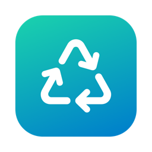
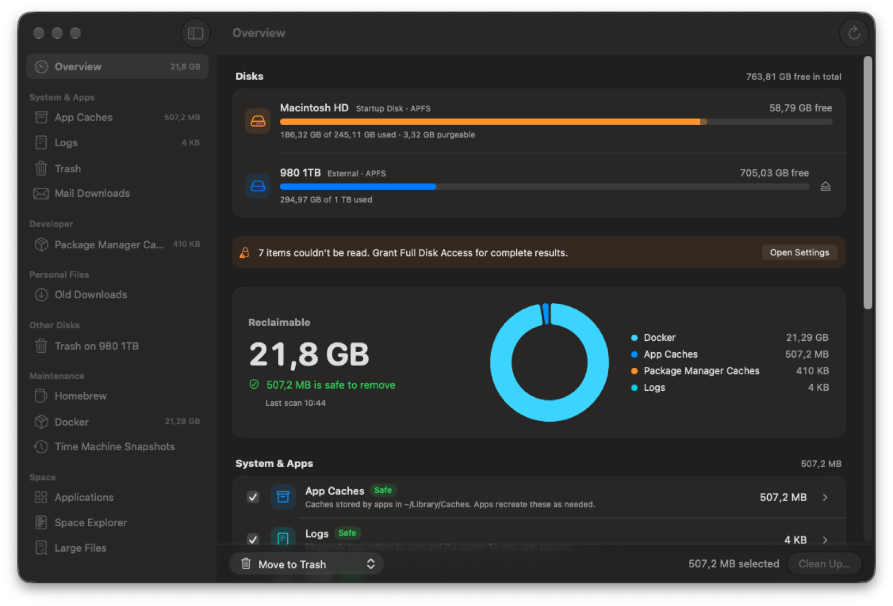

<div align="center">



# Reclaim

**Free, open-source disk cleanup for macOS.** Find out what's eating your disk, then clean it up safely.

[](https://github.com/Unfield/Reclaim/actions/workflows/ci.yml)
[](https://github.com/Unfield/Reclaim/releases/latest)
[](LICENSE)


[**Download**](https://github.com/Unfield/Reclaim/releases/latest) · [Features](#features) · [Command line](#command-line-tool) · [Contributing](CONTRIBUTING.md)



</div>

## Install

With [Homebrew](https://brew.sh) (installs the app and the `reclaim` command):

```sh
brew tap unfield/tap
brew trust unfield/tap     # newer Homebrew versions require this for third-party taps
brew install --cask unfield/tap/reclaim
```

Or manually:

1. Download **Reclaim-x.y.z.dmg** from the [latest release](https://github.com/Unfield/Reclaim/releases/latest).
2. Open it and drag **Reclaim** to **Applications**.
3. The first time, **right-click Reclaim → Open → Open**. Releases aren't notarized by Apple yet, so macOS asks once. If it says the app is "damaged", run:
   ```sh
   xattr -dr com.apple.quarantine /Applications/Reclaim.app
   ```
4. Optional, for complete results: add Reclaim under **System Settings → Privacy & Security → Full Disk Access**.

It's a universal app for Apple silicon and Intel and needs macOS 14 or later. It gets the Liquid Glass look on macOS 26, comes in English and German, and updates itself (Reclaim → Check for Updates…).

## Features

**Clean up**
- **Smart cleanup:** caches, logs, Trash, Xcode data, Simulator caches, package-manager caches, old editor extensions, leftover installers and more. Each category is labelled **Safe**, **Review** or **Caution**, and only Safe items are preselected.
- **Developer tools:** Homebrew cleanup, Docker pruning (containers, images, build cache, volumes), Xcode simulators and Time Machine local snapshots.
- **Undo:** everything Reclaim moves to the Trash can be put back with one click (**Recently Removed**, or ⌥⌘Z).
- **Exclusions:** mark anything "Never Clean This".
- **Scheduled cleanup:** clean Safe items daily, weekly or monthly, with an optional weekly summary.

**Find & remove**
- **App uninstaller:** finds apps you haven't opened in months and removes them along with their support files. You can also drag an app onto Reclaim or its Dock icon.
- **App leftovers:** data left behind by apps that are no longer installed.
- **Developer projects:** `node_modules`, `target`, `.venv`, `.build`, Gradle and Pods folders in projects you haven't touched in a while.
- **Duplicates:** identical files, verified with SHA-256. At least one copy is always kept.
- **AI models:** Ollama, LM Studio, Hugging Face and GPT4All models, with per-model removal.
- **iCloud Drive:** removes local copies of files you haven't opened in a while. They stay in iCloud.
- **Space Explorer:** a list or treemap of any folder or disk, with sizes filling in live.
- **Large Files:** finds the biggest files anywhere.

**Monitor**
- **Memory and CPU & Energy:** live pressure, usage and the heaviest apps, with one-click Quit. There's no "RAM cleaner" snake oil; Reclaim explains what actually helps.
- **Login Items:** what starts automatically. Turn agents off, or remove broken ones.
- **Disk History:** free space over time, with a forecast of when the disk will be full.
- **Every disk:** usage for internal, external and network disks, each disk's own Trash, and an Eject button.
- **Menu bar:** disk and memory at a glance, one-click cleanup, and a notification when space runs low.

**Command-line tool:** almost everything is also scriptable from Terminal.

### What it cleans

| Category | Safety |
| --- | --- |
| App caches (`~/Library/Caches`) | Safe |
| Logs | Safe |
| Trash (all disks) | Safe, permanent |
| Xcode DerivedData, Simulator caches | Safe |
| Homebrew downloads & old versions | Safe |
| Old VS Code / Cursor / Windsurf extension versions | Safe |
| Mail downloads, device support files, package-manager caches | Review |
| Old JetBrains IDE data, Android emulator images, Unity cache | Review |
| Leftover installers (`.dmg`, `.pkg`, `.ipsw`, "Install macOS" apps) | Review |
| Docker unused data, Xcode simulators, Time Machine local snapshots | Review |
| iPhone/iPad backups, Xcode archives, old downloads | Caution |

## Safety

Reclaim is careful by design:

- **Files go to the Trash by default.** Permanent deletion is opt-in.
- Category cleanup only removes items **directly inside** known cache and data folders. It never removes the folders themselves or anything outside them.
- The uninstaller only touches `.app` bundles in Applications folders and support files matched by **exact bundle ID** in `~/Library`. Apple apps are never offered.
- Tool cleanups (Homebrew, Docker, tmutil) use **each tool's own commands**.
- Everything Reclaim moves to the Trash is logged, so you can **put it back** until you empty the Trash.
- Nothing runs as root unless you approve the standard macOS password prompt.
- Everything happens **on your Mac**. No analytics, no accounts. The only network access is the optional update check against GitHub.

## Command-line tool

The CLI is included in each release (`reclaim-cli-*.tar.gz`), or you can build it yourself.

```sh
reclaim status                       # usage for all disks
reclaim scan --details               # what can be reclaimed
reclaim clean --all-safe --dry-run   # preview
reclaim clean xcode-derived-data docker --all-images
reclaim apps --days 180              # apps unused for 6 months
reclaim uninstall "Some App"         # app + support files to the Trash
reclaim explore ~/Library            # what's using space here
reclaim large / --min 2GB            # big files anywhere
reclaim memory                       # memory pressure + heaviest apps
reclaim cpu                          # CPU usage + heaviest apps
reclaim projects ~/Dev --days 90     # rebuildable junk in old projects
reclaim duplicates ~/Downloads       # identical files
reclaim leftovers                    # data from uninstalled apps
reclaim models                       # local AI models
reclaim icloud --days 60             # iCloud files you can download again later
reclaim login-items                  # what starts automatically
reclaim history                      # free space over time + forecast
reclaim undo                         # put back the last cleanup
reclaim exclude ~/Library/Caches/com.spotify.client
```

Run `reclaim help` for every option, and `reclaim list` for the category and tool IDs.

## Build from source

You need macOS 14+ and Swift 6 with the macOS 26 SDK (Xcode 26, or the matching Command Line Tools).

```sh
git clone https://github.com/Unfield/Reclaim.git && cd Reclaim
./scripts/test.sh                  # tests
./scripts/build-app.sh             # build/Reclaim.app and build/reclaim
./scripts/build-app.sh --install   # ...and copy the app to /Applications
./scripts/package.sh               # release DMG, zip and CLI tarball in dist/
```

### Project layout

```
Sources/
  ReclaimCore/     Scanning, sizing, cleaning, disks, apps, tools (no UI)
  reclaim/         Command-line tool
  ReclaimApp/      SwiftUI app, menu bar, settings
Tests/             Swift Testing suites
scripts/           build, package, test, icon generation
.github/           CI and release workflows
```

## Contributing

Contributions are welcome, especially new cleanup categories with good safety reasoning. See [CONTRIBUTING.md](CONTRIBUTING.md).

## License

[MIT](LICENSE)
